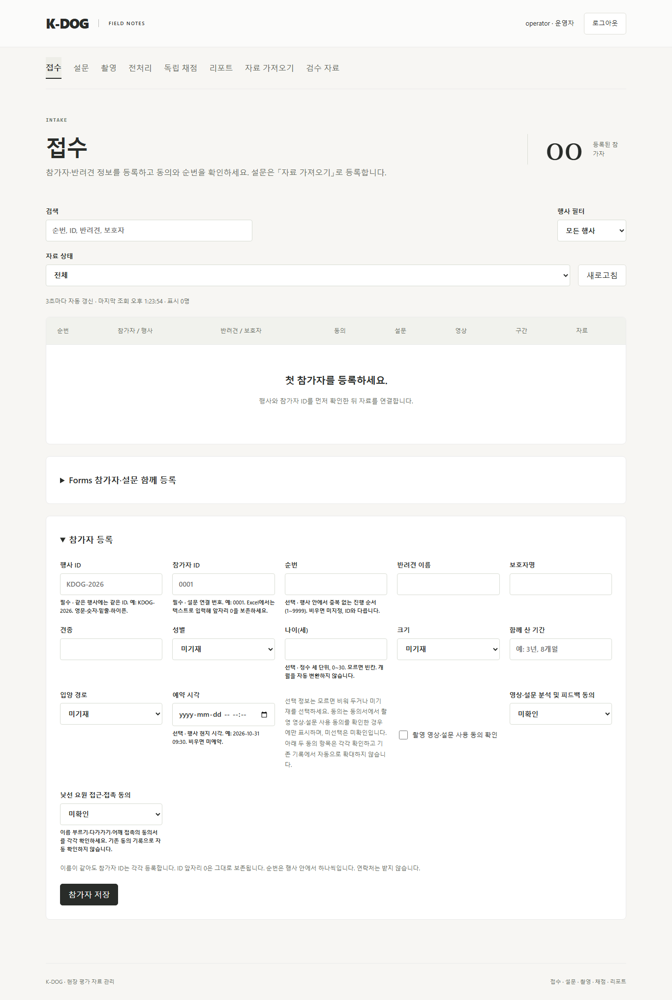

# K-DOG UI·UX 개편 계획

버전: v1.0 · 2026-10-11 · 상태: 계획 (구현 전) · 기준: main `24411c9`

기능 기준은 [S1 개발 반영 계획](../개발반영_20261003/K-DOG_개발반영계획_v1.0_20261003.md)을 그대로 따른다. 이 계획은 S1 채점·계산·리포트 규칙을 바꾸지 않고 **화면 구조, 현장 등록 흐름, 안내 문구**를 바꾼다. 공통 구현·검증·리뷰·버전 확인 절차는 상위 계획 §7을 적용한다. 앞선 [UI·UX 개선 Cold Review(2026-10-05)](../개발반영_20261003/K-DOG_UIUX개선ColdReview_v1.0_20261005.md)의 모바일 알림·참가자 맥락·촬영 구역 접기는 유지한다.

## 1 배경

2026-10-11 사용자 관점 점검을 했다. 실제 영상·LLM은 쓰지 않았고 `tests.browser_server` 합성 서버(키·worker 없음)와 합성 바이트 파일만 썼다. 운영자·교수/검토자·관리자·개발자 4역할, 1366·820·390px에서 화면을 돌았다. 확인된 문제는 다음과 같다.

| 번호 | 화면 | 관찰 |
| --- | --- | --- |
| F01 | 전체 | 상단 가로 메뉴 8~10개가 같은 수준으로 나열된다. 현장 진행(접수·설문·촬영)과 분석(전처리·채점·리포트), 관리 기능이 구분되지 않는다. 휴대폰에서는 메뉴가 두 줄로 접힌다. 새로고침하면 항상 접수로 돌아간다 (`page`가 URL에 없다). |
| F02 | 접수 | 참가자를 저장하면 상세 화면으로 넘어가고 등록 폼이 접힌다. 다음 참가자를 받으려면 「← 접수 목록」 → 「참가자 등록」 펼치기를 반복해야 한다. |
| F03 | 접수 | 순번만 중복돼도 「중복 ID 또는 연결 충돌입니다」라고만 표시해 어느 칸이 문제인지 알 수 없다. 형식 오류는 브라우저 기본 툴팁뿐이다. |
| F04 | 접수 | 목록 행을 눌러도 열리지 않는다. 「열기 ↗」 버튼만 동작하고 ↗는 새 창처럼 보인다. 채점 전 신규 참가자에게 「S1 재분석 필요」가 표시된다. |
| F05 | 자료 가져오기 | 열을 읽은 뒤 연결을 비운다 ([FormsImporter.tsx:55](../../frontend/src/FormsImporter.tsx#L55)). 헤더가 「참가자 ID」「Q01」처럼 같아도 기본 15칸 + 문항 28 + 빈칸 사유 28을 매번 손으로 고른다. 연결 설정 저장·재사용이 없다. |
| F06 | 자료 가져오기 | 「Forms 등록 미리보기」가 행사 ID 미입력 때 이유 없이 비활성이다. 「원자료 프로필」「매핑 버전」을 직접 입력하게 한다. 「과거 판본 원자료 참고만 등록」 체크박스가 빈 사각형으로 크게 그려진다. |
| F07 | 자료 가져오기 | 이미 접수한 참가자 ID가 파일에 있으면 행마다 대상을 직접 연결하지 않는 한 오류다 ([forms_v4.py:348-349](../../backend/app/forms_v4.py#L348-L349)). 한 행이라도 오류면 파일 전체를 확정할 수 없다. 현장에서 접수 후 설문 파일을 올리는 흐름이 막힌다. |
| F08 | 촬영 | 안내는 「원본1→CAM1 · 원본3→CAM2 · 원본2→CAM3」인데 모든 카드가 CAM1·원본 번호 1로 채워진다. 연결 완료 카드에 회차 UUID가 노출된다. 해시·수신 ID가 크게 보인다. 처음 연결도 「대상 연결·충돌 재시도」라고 쓴다. |
| F09 | 촬영 | 선택한 참가자의 촬영 기록 패널이 수신 보관함 아래에 있어 미연결 파일이 많으면 길게 스크롤해야 한다. 연결 완료 후에도 「영상 0개」로 보인다 (worker 없는 합성 서버 관찰, 영상 읽기 확인 대기 상태 표시 부재). |
| F10 | 전처리·채점·리포트 | 세 화면이 같은 3열 표를 따로 구현한다. 참가자별 진행 단계가 보이지 않는다. 채점을 막는 선행 조건(촬영 확정·전처리·평가자 배정)이 상태 문구 3줄로 흩어진다. |
| F11 | 교수 화면 | 「G01/G04 수령 후」「S16 측정 대기」「기본 예정 공급자 호출 43회」「교수 테스트 대기」 같은 개발 내부 코드가 교수/검토자에게 보인다. |
| F12 | 전체 | 「자동으로 확대하지 않습니다」「임의 보관기간은 적용하지 않습니다」처럼 정책 부정문이 화면마다 길게 반복된다. 다음 행동 안내가 묻힌다. |



[열 연결 화면](images/review-import-mapping-20261011.png) · [촬영 화면](images/review-recording-20261011.png) · [교수 채점 화면](images/review-reviewer-scoring-20261011.png)

## 2 사용자와 사용 맥락

| 사용자 | 역할 | 맥락과 요구 |
| --- | --- | --- |
| 행사 스태프 | 운영자 | 학교 행사 현장, 노트북·태블릿. 대기 줄이 있고 IT에 익숙하지 않다. 사전 신청 명단이나 Google Forms 응답을 CSV/Excel로 받아 **올리기만 하면** 등록되기를 원한다. 실수했을 때 무엇을 고칠지 바로 알아야 한다. |
| 교수자 | 교수/검토자 | 행사 후 연구실에서 채점·검토. 개발 진행 상태나 내부 코드가 아니라 **지금 채점할 수 있는지, 아니라면 누가 무엇을 해야 하는지**를 원한다. 입력 권한은 없다. |
| 운영 관리자 | 관리자 | 계정·백업 관리. 현장 기능도 쓴다. |
| 개발자 | 개발자 | AI 키·설정 전용. 이 계획의 범위 밖이며 화면을 바꾸지 않는다. |

## 3 목표와 비목표

목표:

1. **좌측 LNB와 상위·하위 메뉴**로 현장 진행 → 분석·평가 → 자료 관리 순서가 보이게 한다. 현재 위치는 URL(hash)에 남아 새로고침·뒤로가기 후에도 유지된다.
2. **현장 등록은 업로드 중심으로 쉽고 유연하게**: 표준 양식 내려받기 → 파일 올리기 → 자동 열 연결 확인 → 미리보기 → 등록의 단계형 흐름. 헤더가 같거나 알려진 별칭이면 자동 연결하고, 명단만 있는 파일·설문만 있는 파일·둘 다 있는 파일을 모두 받는다.
3. 단건 접수는 **연속 등록**이 가능하고 오류는 해당 칸에 표시한다.
4. 분석 단계 화면은 **참가자별 진행 단계와 선행 조건 체크리스트**를 공통으로 보여준다.
5. 교수/스태프 화면에서 **개발 내부 코드와 정책 부정문을 걷어내고** 다음 행동 한 줄을 앞에 둔다.

비목표:

- S1 채점·계산·판정·리포트 문장 규칙, 데이터 계약, 저장 형식 변경
- 이름·견명·보호자명으로 기존 참가자를 추정하는 연결 (S02 원칙 유지)
- 새 UI 라이브러리·라우터·상태관리 도입 (React·CSS 기존 조합으로 구현. hash는 `window.location`으로 처리)
- 개발자 화면(키·AI 설정) 개편, 실제 공급자·실제 영상 검증
- 연락처 수집, 다국어

## 4 정보 구조 (LNB)

```
현장 운영
├─ 참가자 접수            (현재 「접수」 목록·단건 등록)          #/intake
├─ 일괄 등록 (CSV·Excel)   (현재 「자료 가져오기」)                 #/intake/upload
├─ 설문 현황              (현재 「설문」)                          #/survey
└─ 촬영
   ├─ 영상 수신·연결      (UploadInbox)                            #/recording/inbox
   └─ 촬영 기록 (8구간)   (RecordingPanelV4·보존 원본 등록)         #/recording/record
분석·평가
├─ 전처리                                                          #/preprocess
├─ 독립 채점                                                       #/scoring
└─ 리포트
   ├─ 리포트 발급                                                  #/report
   ├─ 비교 조건           (ComparisonSettings)                     #/report/comparison
   └─ 연구 내보내기       (현재 독립 채점 하단 details)             #/report/export
자료 관리
├─ 검수 자료                                                       #/validation
├─ 직원 계정  (관리자)                                             #/admin/users
└─ 백업·복구  (관리자)                                             #/admin/backup
```

- 역할별 노출은 현재 `menu[].roles`와 같다. 교수/검토자는 현장 운영(읽기)·전처리·독립 채점만 본다 (리포트 권한은 Q03 결정에 따름). 개발자는 LNB 없이 기존 개발 설정 화면을 유지한다.
- 1024px 이상: 좌측 고정 LNB(약 220px) + 본문. 768~1023px: 아이콘 없이 접을 수 있는 LNB. 767px 이하: 상단 「메뉴」 버튼으로 여는 서랍(drawer), 포커스 가두기와 Esc 닫기.
- 선택 참가자 맥락 바는 본문 상단에 유지하고, 현장·분석 메뉴 사이를 이동해도 선택을 유지한다 (현행 동작).
- 미저장 입력 보호(`mayLeave`)는 LNB 클릭과 `hashchange` 모두에 적용한다.

## 5 확정된 결정과 확인 필요 사항

확정 (2026-10-11 사용자 지시):

| 번호 | 결정 |
| --- | --- |
| K01 | 좌측 LNB를 두고 상위·하위 메뉴 구조를 적극 활용한다. |
| K02 | 현장 참가자 등록은 CSV 또는 필요한 항목을 담은 양식 파일 업로드 구조로 하고, 쉽고 유연하게 만든다. |
| K03 | 개편은 이 폴더의 PR 단위로 진행한다. 각 PR은 구현 → 검증 → cold review → 수용 판단 → 수용안 반영 → 푸시 순서를 따르고, UI는 대메뉴 단위로 나눈다. |

확인 필요 (권장안을 기본으로 계획했으며, 다른 결정이면 해당 PR 범위를 조정한다):

| 번호 | 질문 | 권장안 | 영향 PR |
| --- | --- | --- | --- |
| Q01 | 업로드 파일의 참가자 ID가 이미 접수된 ID와 **정확히 같으면** 그 참가자를 자동으로 갱신 대상으로 잡아도 되는가? | 허용. 미리보기에 「기존 참가자 갱신」으로 행마다 표시하고, 운영자가 「확인」을 눌러야 확정한다. 이름 기반 추정은 계속 금지한다. S02의 "명시적 연결"은 미리보기 확인으로 충족한다. | U03 |
| Q02 | 일부 행에 오류가 있으면 정상 행만 등록해도 되는가? | 허용. 확정 버튼에 「정상 N행 등록 · 오류 M행 제외」를 표시하고, 제외 행은 오류 사유를 붙인 CSV로 내려받는다. 조용히 숨기지 않는다 (S02 §3). | U03 |
| Q03 | 교수/검토자에게 리포트 조회(발급은 제외)를 열어야 하는가? | 조회만 허용. 발급·재발급은 운영자·관리자 유지. | U06 |
| Q04 | 종이 설문 등 화면 직접 입력이 필요한가? | 이번 범위 제외. 표준 양식 Excel에 옮겨 적어 올리는 방식으로 대응한다. | — |
| Q05 | 열 연결 설정 저장 위치 | 서버에 저장해 같은 현장 PC들이 공유한다 (3PC 운영). | U03 |

## 6 PR 목록과 선행 관계

| PR | 문서 | 목적 | 선행 |
| --- | --- | --- | --- |
| U01 | [LNB 셸과 메뉴 구조](K-DOG_PR-U01_LNB셸과메뉴구조_v1.0_20261011.md) | 좌측 LNB, 상위·하위 메뉴, hash 위치 유지, 모바일 서랍. 화면 내용은 그대로 옮긴다 | 없음 |
| U02 | [일괄 등록 표준 양식과 자동 연결](K-DOG_PR-U02_일괄등록양식과자동연결_v1.0_20261011.md) | 표준 양식 내려받기, 헤더·별칭 자동 연결, 단계형 업로드 화면, 비활성 사유 표시 | U01 |
| U03 | [일괄 등록 기존 참가자와 부분 등록](K-DOG_PR-U03_일괄등록기존참가자와부분등록_v1.0_20261011.md) | ID 일치 기존 참가자 갱신 후보, 정상 행만 등록, 오류 행 CSV, 연결 설정 저장 | U02, Q01·Q02·Q05 |
| U04 | [참가자 접수 연속 등록과 칸 오류](K-DOG_PR-U04_접수연속등록과칸오류_v1.0_20261011.md) | 저장 후 다음 참가자, 칸 단위 중복·형식 오류, 행 클릭 열기, 동의 묶음, 상태 용어 | U01 |
| U05 | [촬영 영상 연결과 기록 분리](K-DOG_PR-U05_촬영영상연결과기록분리_v1.0_20261011.md) | 파일명 기반 카메라 기본값, 회차 이름 표시, 상세 접기, 수신·기록 하위 메뉴 분리, 읽기 대기 상태 | U01 |
| U06 | [분석 단계 진행 현황과 교수 화면](K-DOG_PR-U06_분석단계진행현황과교수화면_v1.0_20261011.md) | 전처리·채점·리포트 공통 참가자 목록과 진행 단계, 선행 조건 체크리스트, 연구 내보내기 이동, 교수 문구 | U01, Q03 |
| U07 | [문구 기준과 통합 검증](K-DOG_PR-U07_문구기준과통합검증_v1.0_20261011.md) | 화면 문구 기준표 적용 점검, 역할별 시나리오 e2e, 합성 현장 리허설, 운영 안내 갱신 | U01–U06 |

U02·U04·U05·U06은 U01 이후 서로 독립이라 순서를 바꾸거나 나눠 진행할 수 있다. 각 PR은 단독 병합해도 기존 기능과 e2e가 깨지지 않아야 한다. U01만 병합된 상태에서도 모든 기능을 새 메뉴에서 그대로 쓸 수 있다.

## 7 화면 문구 기준

모든 PR에 적용하고 U07에서 전체를 점검한다.

1. **다음 행동을 먼저** 쓴다. 「영상을 연결하세요」처럼 한 줄. 정책·근거 설명은 「자세히」 접기 안으로 옮긴다. 정책 내용은 지우지 않는다.
2. 운영자·교수 화면에 **개발 진행 코드**(S1, S1.1, S16, G01~G05, D01~D06, R/T 번호, 「교수 테스트 대기」, 「공급자 호출 N회」)를 쓰지 않는다. 필요한 경우 「준비 중인 기능입니다」 수준으로 바꾸고 원문은 개발자 화면·문서에 남긴다. 평가 항목 코드(개59, 보10 등)는 교수가 쓰는 도메인 용어이므로 유지한다.
3. 내부 식별자(UUID, SHA-256, 수신 ID, 입력 버전)는 기본 접힘 「기술 정보」로 옮긴다. 회차는 「1차 촬영」처럼 이름으로 쓴다.
4. 비활성 버튼은 옆에 **빠진 조건**을 쓴다.
5. 오류는 **칸 옆**에, 무엇이 왜 틀렸고 어떻게 고치는지 쓴다. 전역 알림은 요약만.
6. 아직 채점 전인 상태를 「재분석 필요」처럼 과거 이력이 있는 것처럼 쓰지 않는다.

## 8 공통 검증

- 화면 PR: `npm run build`, 변경 화면과 공통 권한·참가자 맥락·미저장 입력 회귀(`layout`, `context`, `notifications`, `guidance`, 해당 메뉴 spec), 최종 PR에서 전체 `npm run test:e2e`.
- backend를 바꾸는 PR(U02 양식, U03, U04 오류 코드): 전체 `unittest`, `--spec 20261002 --check`.
- 모든 PR: `git diff --check`, `graft build` → `graft check`, 문서 상대 링크 확인.
- 기존 e2e는 `navigation "주 메뉴"`와 메뉴 버튼 이름에 의존한다. U01에서 LNB도 `aria-label="주 메뉴"`를 유지하고, 이름을 바꾸는 메뉴는 같은 PR에서 시험을 함께 고친다.
- 실제 영상·외부 AI·실제 참가자 자료는 쓰지 않는다. 합성 서버와 합성 바이트 파일로 검증하고, 실측은 [후속 대장](../개발반영_20261003/K-DOG_실측및확인후속대장_v1.0_20261003.md)의 경계를 유지한다.
- 새 라이브러리는 도입하지 않는다. 기존 의존성(React, Vite, TypeScript, Playwright)을 쓰는 경우에도 구현 착수일에 공식 registry·릴리스로 최신 안정판과 호환성을 확인해 각 PR 기록에 남긴다.

## 9 완료 기록

각 PR 문서의 「구현 및 검증 기록」에 실제 commit/PR, 검증 결과, 버전 확인, cold review 수용·보류·거절과 조치를 적는다. 체크박스는 근거가 있을 때만 체크한다. 이 계획 문서만으로 구현이 실행된 것으로 보지 않는다.
