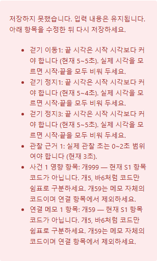

# K-DOG 촬영 기록 입력 검증 수정

버전: v1.0 · 2026-10-23

## 문제와 변경

촬영 기록 저장 시 걷기 이동1·정지1·정지3의 종료≤시작, 관찰 범위보다 큰 관찰 초수, 사건·연결 메모의 잘못된 항목 코드가 서버 검증 오류로 노출됐다. 기존 화면은 이 조건을 사전 검사하지 않았다.

- 실제 8구간·걷기 국면의 종료≤시작, 관찰 근거의 종료≤시작·관찰량 범위, 사건·메모의 S1 항목 코드를 저장 전에 검사한다.
- 저장 버튼 아래에 한국어 오류 목록과 수정 위치·현재 값·수정 방법을 표시한다. 오류가 있으면 PUT 요청을 보내지 않고 미저장 입력을 유지한다.
- 연결 코드는 기존 `/api/catalog/behavior-s1` 카탈로그로 검증한다. 코드 입력 예시와 개59 자체는 연결 항목이 아니라는 설명을 추가했다.
- 서버 계약·채점 규칙은 변경하지 않았다. 선택 관찰의 빈 시각은 그대로 허용한다. 이미 작업 폴더에 있던 절차 확인 근거 선택 입력 수정은 보존했다.

근거: [S04](../archive/개발반영_20261003/K-DOG_PR-S04_촬영사건과관찰창_v1.0_20261003.md), [인수 검증 대장 T06/T19/O07](../archive/개발반영_20261003/K-DOG_인수검증대장_v1.0_20261003.md). 기존 S1 계약의 입력 안내 보완이며, 고객 원본·운영 자료·실측 수용 상태는 변경하지 않는다.

## 검증

- 회귀 테스트: 합성 영상에서 보고된 6개 오류를 재현하고, 한국어 목록·PUT 차단·입력 보존·수정 후 실제 API 저장을 확인한다. 빈 걷기 시각과 유효한 사건/메모 코드도 확인한다.
- 수정 전 새 테스트는 오류 안내가 없어 실패했다.
- `npm run build`: 성공(69 modules). 기존 500kB 번들 크기 경고는 유지된다.
- `npm run test:e2e -- tests/recording-v4.spec.ts tests/recording-split-v4.spec.ts`: 기존 11개 통과. 새 테스트의 메모 보존 확인은 역할·접근성 이름으로 조회하도록 고쳤다. 안내 추가 시 입력 이름이 바뀌던 문제는 명시적 `aria-label`로 수정했다.
- `npm run test:e2e -- tests/recording-v4.spec.ts -g '촬영 저장은'`: 신규 1개 통과. 390px 한국어 오류 목록 스크린샷을 육안 확인했다. 화면 크기 변경 후 레이아웃 완료를 기다리도록 너비 검사는 polling assertion을 사용한다.
- `git diff --check`, 문서 상대 링크, `graft check`: 통과. graft 로컬 그래프를 갱신했다. 운영 DB·참가자 자료는 테스트에 사용하지 않았다.

## 라이브러리 확인

2026-10-23 공식 npm 레지스트리의 `latest`와 선택 버전 metadata, 공식 문서·릴리스 노트를 조회했다. 의존성 추가·설치는 없으며 기존 잠금 버전을 유지한다. 이번 오류는 입력 검증 문제이므로 관련 없는 업그레이드를 포함하지 않는다.

| 패키지 | 최신 안정판 | 선택 버전 | 공식 근거 |
| --- | --- | --- | --- |
| React / React DOM | 19.3.1 | 19.2.8 | [registry](https://registry.npmjs.org/react/latest), [React 버전](https://react.dev/versions), [input API](https://react.dev/reference/react-dom/components/input) |
| Playwright Test | 1.64.1 | 1.63.0 | [registry](https://registry.npmjs.org/@playwright%2ftest/latest), [릴리스](https://playwright.dev/docs/release-notes), [assertions](https://playwright.dev/docs/test-assertions) |
| TypeScript | 7.0.2 | 7.0.2 | [registry](https://registry.npmjs.org/typescript/latest), [릴리스 문서](https://www.typescriptlang.org/docs/handbook/release-notes/overview.html) |
| Vite | 8.3.5 | 8.2.2 | [registry](https://registry.npmjs.org/vite/latest), [지원 버전·릴리스](https://vite.dev/releases) |

실행 Node 24.18.1은 선택 Playwright의 Node≥20 및 Vite의 Node≥22.12 요구를 충족한다. 선택 React DOM의 peer `react ^19.2.8`도 충족한다. 기존 controlled input/useState와 Playwright locator/assertion API를 사용하며 새 버전 전용 API 또는 파괴적 변경을 도입하지 않는다.

## 같은 날 후속: CSV의 빈 카메라 시각

사용자 제공 CSV의 첫 입장 행은 CAM1~CAM4 영상 시각이 모두 빈칸이었다. 기존 `seconds()`가 빈값을 숫자 오류로 처리해 파일 전체 가져오기를 거절했다. 사용자는 자동 처리를 요청했다.

- 기준 카메라 시각이 빈 행은 해당 구간의 기존 입력을 유지하고 경고한다. 새 입력이면 미확인 상태로 남는다. `경과초(녹화시작기준)`를 영상 시각으로 대체하거나 0으로 채우지 않는다. 확정 전에 실제 경계를 확인해야 한다.
- 다른 카메라 오프셋은 두 카메라 모두 시각이 있는 공통 행만 사용한다. 사용 행 수를 안내하며 공통 행이 없으면 기존 오프셋을 보존한다.
- 실제 0초는 유효하다. 음수·숫자가 아닌 값·중복 구간·역순·잘못된 CSV의 거절은 유지한다. 중간 구간 시각이 비어도 그 다음 구간으로 앞 구간 끝을 건너뛰어 채우지 않는다.
- 기존 [VC03](4카메라구간CSV전환_20261014/K-DOG_PR-VC03_구간CSV가져오기_v1.0_20261014.md)의 빈값 일괄 거절만 이 요청으로 변경했다. 저장·확정 API 및 채점 규칙은 유지한다.
- 검증: 수정 전 새 합성 회귀 3건 실패 → 수정 후 CSV 관련 12건 통과, 빌드 성공. 사용자 파일을 로컬에서 CAM1~CAM4 각각 기준으로 파싱하여 유효 7구간·3개 오프셋·입장 경고를 확인했다. 원본 CSV는 변경하거나 저장소로 복사하지 않았다. 검증용 임시 테스트는 확인 후 제거했다. 브라우저 회귀에는 합성 CSV만 사용한다.
- 촬영 브라우저 5건 통과. 빈 시각 CSV의 초안 저장200·입장 null 보존·완전한 CSV로 보완 후 확정200을 검증했다. 테스트가 첫 저장 완료·입력 판본 갱신을 기다리지 않고 다음 입력을 시작해 발생한 409는 저장 완료 안내를 기다리도록 테스트를 정정한 뒤 재검증했다.
- 라이브러리·잠금 버전은 위 같은 날짜 확인을 재사용한다. 새 의존성은 없다.

## 병합 검토

2026-10-23 사용자 병합·로컬/원격 동기화 요청에 따라 `veluga/recording-validation-csv-20261023`으로 분리했다. 절차 확인 근거 선택 입력은 이미 main의 PR #132에 반영되어 이 PR에서는 제외한다.

최종 diff에서 오류 시 입력 유지·PUT 차단, 카탈로그 기반 코드 검증, 빈 시각/0/음수 구별, 공통 행 없는 오프셋 보존, 원본 CSV 미포함을 검토했다. 추가 수정 사항은 없었다. 합성 화면 확보를 위해 새 입력 검증 브라우저 테스트 1건을 다시 실행하여 통과했다. 미입력 경계의 실제 확인과 현장/공급자 인수는 기존 경계를 유지한다.

