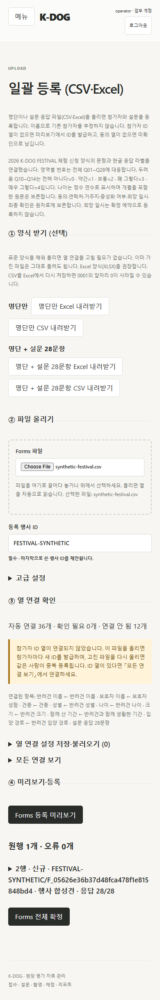

# K-DOG 행사 신청 설문 반영

버전: v1.0 · 2026-10-22 · 기준: `main / accab04` · 작업 브랜치: `veluga/festival-survey-20261022`

현재 상태 갱신: 2026-10-23 · 독립 cold review 3명, P2 3건 수용·수정·재검토 완료. 최종 관련 backend 85개·브라우저 16개·빌드 통과. 상세 발견과 조치는 [Cold Review 기록](K-DOG_행사신청설문_ColdReview_v1.0_20261023.md)을 따른다.

## 1 원본과 적용 범위

사용자가 전달한 `docs/참고자료/2026 K-DOG FESTIVAL AI 반려견 행동상담소 체험 신청(응답).xlsx`의 신청 설문 형식을 접수 가져오기에 반영했다. 원본은 로컬 전용이며 응답자 이름·연락처·실제 응답을 코드, 시험 fixture, 화면 근거에 넣지 않았다.

| 원본 확인 | 값 |
| --- | --- |
| SHA-256 | `7f3dac9e4189b6f191becbcdfd77d50245b0b4234007f32bb3957122d5c4cd83` |
| 설문 시트 | `설문지 응답 시트1` |
| 문항 확인 범위 | `A1:AV1` 48열, 설문은 `T1:AU1` 28문항 |
| 다른 시트 | `입금명단`은 별도 시트이며 설문 응답과 합치지 않는다. |
| 반영 자산 | [행사 연결 규칙](../../resources/mappings/forms-festival-20261022.json), `forms-festival-20261022-v1` / `kdog-festival-2026` |

원본 문항을 현재 S1의 동일 주제 28항목에 연결하는 가져오기 변경이다. Q07·Q08의 입양 시기 보조 문구 생략, 두려움 문항의 “불안해한다” 추가, “아이”→“반려견” 표현 변경과 선택지 문구 차이를 원본 헤더로 기록했다. 기존 `survey-v3.json` 원문과 S1 계산 정책, 과거 입력/발급 산출물은 수정하지 않았다. 이 연결이 측정 동등성이나 외부 연구 비교의 추가 검증을 뜻하지 않는다. 관련 요구사항은 R02·R07·R18, 인수 항목은 O01·T14·T25다.

## 2 입력과 저장 동작

영역별로 반복되는 1번을 전체 설문 번호로 추정하지 않고, 확인한 문항 원문으로만 연결한다.

| 행사 파일 범위 | 앱 항목 | 응답 라벨 대응 |
| --- | --- | --- |
| T:AB (9문항) | Q01~Q09 | 전혀 아니다=1, 아니다=2, 보통=3, 그렇다=4, 매우 그렇다=5 |
| AC:AG (5문항) | Q10~Q14 | 전혀 아니다=0, 약간=1, 보통=2, 꽤 그렇다=3, 매우 그렇다=4 |
| AH:AN (7문항) | Q15~Q21 | 동의 척도 1~5 |
| AO:AR (4문항) | Q22~Q25 | 동의 척도 1~5 |
| AS:AU (3문항) | Q26~Q28 | 동의 척도 1~5 원응답 저장, 기존 계산 단계에서 `6−원응답` 역채점 |

파일 선택 시 기존 열 연결·응답 라벨 설정을 제안한다. 행사 문항이 확인되면 원자료 프로필/연결 판본과 문항별 한글 라벨을 함께 채운다. 파일·시트를 변경하면 그 파일에 맞게 다시 제안한다. 표준 숫자 응답 및 일반 사용자 설정, 명시적 기존 참가자/회차 연결·원행 미리보기·확정·재시도 보호는 기존 경로를 쓴다.

자동 연결 36개는 설문 28개와 보호자 성함·견명·견종·성별·나이·크기·함께 생활한 기간·입양 경로 8개다. 선택한 행사 프로필에서 명시적으로 연결한 표준 접수 필드에 한해 `암컷/수컷`→`암/수`, `소형견/중형견/대형견`→`소형/중형/대형`, `가정분양`→`분양`, `입양(보호소 등)`→`입양`을 적용한다. 원본 헤더의 공백이나 보조 표기가 달라도 연결한 필드 의미를 사용하며, 일반 프로필에는 이 변환을 적용하지 않는다.

행사 응답 기본 라벨은 최종 열 연결에서 계산하므로 수동 연결과 프리셋의 충돌 해결에도 적용된다. 사용자가 입력한 라벨과 명시적으로 지운 빈 라벨은 기본값보다 우선하며, 빈 라벨도 문항별 빈 매핑으로 프리셋에 저장해 다시 불러올 때 보존한다.

나이는 기존 정수 연수 필드에 맞춘다. `10개월`→0, `1살 7개월`→1, `3년 2개월`→3이다. 개월 포함 원문을 불변 원행에 보존한다. `약 3살` 등 모호한 표현, 연수 뒤 12개월 이상인 잘못된 구성, 범위 밖 값은 오류로 남긴다. 함께 생활한 기간은 문자열 그대로 보존한다. 실제 원본 25행은 이 범위로 모두 읽혔다.

타임스탬프, 동의 4열, 희망일/시간대 3열, 연락처, 거주지, 중성화 여부, 최종 확인 12열은 원파일/원행 출처에 보존한다. 희망 시간을 확정 예약 시각으로 만들지 않는다. 동의는 현행 업무 권한의 조건으로 쓰지 않는다. 중성화 여부 때문에 원래 성별을 덮어쓰지 않는다. 참가자 ID가 없는 원본은 기존 규칙대로 새 ID를 발급하며 재업로드 중복 주의 안내를 유지한다.

## 3 구현 및 검증

- 프런트엔드/백엔드는 같은 비식별 JSON 연결 자산을 사용한다. 백엔드의 전용 접수 어댑터만 추가하고 저장 모델이나 DB 스키마는 변경하지 않았다.
- launcher 필수 자산에 연결 JSON을 포함했다. 기존 배포 allowlist의 `resources/*.json` 및 `backend/app/*.py` 포함 규칙으로 패키징된다.
- 신규 ID가 포함된 긴 미리보기 제목의 모바일 줄바꿈을 보완했다.

| 확인 | 결과 |
| --- | --- |
| 원본 읽기 검증 | hash/48개 헤더 일치, 선택 시트 25행 정상, 오류 0, 25행 모두 28문항 응답. 임시 저장소만 사용하고 운영 DB 등록/확정은 실행하지 않음 |
| backend | `uv run --locked python -X utf8 -m unittest tests.test_forms_import_v4 tests.test_forms_api_v4 tests.test_survey_v4 tests.test_packaging -v` — 최종 85개, 56.274초, OK |
| frontend build | `npm run build` — 통과. 500 kB 초과 번들 경고는 남음 |
| 브라우저 | `$env:KDOG_TEST_INTAKE_SPEC='20261002'` 후 `npx --no-install playwright test tests/forms-auto-map.spec.ts tests/importer-upload-v4.spec.ts tests/survey-v4.spec.ts` — 최종 16개, 19.6초, 통과 |
| 신규 회귀 | 28개 문항의 반복 번호 구별, 공포 0~4의 다섯 라벨, Q26 원응답 보존, 성별/크기/나이/입양 경로 변환, 불변 원행 출처, 확정 재시도, 표준 파일 전환 시 행사 설정 제거, 390px 가로 넘침 없음 |

초기 시험에서 XLSX 빈 셀을 빈 문자열로 기대한 fixture를 실제 읽기 값 `None`으로 수정했다. Node에서 공유 JSON을 읽도록 import attribute를 명시했다. 모바일 미리보기의 긴 새 ID 줄바꿈과 브라우저 시험의 확정 완료 대기를 보완한 뒤 위 최종 결과를 확인했다. 시험 중 로컬 Node 실행 파일 교체로 중단된 실행은 통과 근거에 포함하지 않았다.

최초 구현 시험은 backend 84개(36.030초)·브라우저 14개(12.8초)였고 이번 사용자 요청에 따라 독립 검토 전에 같은 범위를 다시 실행해 84개(42.701초)·14개(16.2초)를 통과했다. 독립 cold review의 P2 3건을 수정하고 위 최종 검증을 수행했다. 횟수를 합산해 전체 시험 수로 표시하지 않는다. 수정 중 라벨 변수 이름 충돌은 빌드에서 검출해 수정했고 이후 빌드·브라우저가 통과했다.

독립 검토와 재검토로 문항 전체 번호·원척도·원본 유지·원파일 보존·재시도·배포 자산 포함을 확인했다. 외부 AI 호출, 실제 참가자 운영 등록, 기존 설문 재계산/점수 초기화, 설치 배포는 실행하지 않았다. Git 반영은 사용자가 2026-10-22~23에 요청한 원격·로컬 병합 절차로 진행하며 §5에 연결한다.

## 4 라이브러리 확인

2026-10-22에 공식 레지스트리와 문서를 확인했다. 새 의존성을 도입하지 않고 저장소의 고정 manifest/lockfile을 유지했다. 최신판으로의 변경은 이 설문 연결 범위를 넘어 별도 호환성 회귀가 필요하므로 수행하지 않았다. Python 3.14와 Node 24.22.1 환경에서 기존 API로 위 검증을 수행했다.

| 라이브러리 | 최신 안정판 | 선택판 | 공식 근거 |
| --- | --- | --- | --- |
| openpyxl | 3.1.5 | 3.1.5 | [PyPI](https://pypi.org/project/openpyxl/), [읽기/쓰기 API](https://openpyxl.readthedocs.io/en/stable/tutorial.html) |
| Pydantic | 2.14.1 | 2.13.5 | [PyPI](https://pypi.org/project/pydantic/) |
| FastAPI | 0.159.1 | 0.141.1 | [공식 레지스트리](https://pypi.org/pypi/fastapi/json) |
| React | 19.3.1 | 19.2.8 | [공식 레지스트리](https://registry.npmjs.org/react/latest), [state API](https://react.dev/reference/react/useState) |
| Playwright | 1.64.1 | 1.63.0 | [npm](https://www.npmjs.com/package/%40playwright/test?activeTab=versions), [assertions API](https://playwright.dev/docs/test-assertions) |
| TypeScript | 7.0.2 | 7.0.2 | [공식 레지스트리](https://registry.npmjs.org/typescript/latest) |
| Vite | 8.3.5 | 8.2.2 | [공식 레지스트리](https://registry.npmjs.org/vite/latest) |

레지스트리상 openpyxl은 Python ≥3.8, Pydantic/FastAPI 최신판은 Python ≥3.10, Playwright 최신판은 Node ≥20, Vite 최신판은 Node ^20.19.0 또는 ≥22.12.0이다. 이 작업은 선택판 API를 그대로 사용하며 peer 추가 설치나 breaking API 이관을 수행하지 않았다.

## 5 Git 반영 기록

구현·수용 수정·검증·cold review 기록 commit은 `82c6314508b896ae728cc8133d2c1649d17553f4`이며 원격 브랜치에 푸시했다. [PR #124](https://github.com/syleeVeluga/k-dog-proj/pull/124)에 요구사항·검증·리뷰·합성 화면을 연결했다. 연결 GitHub 도구의 PR 생성 403 이후 기존 인증된 GitHub CLI로 생성했다.

위 구현 head 조회에서 `CLEAN`/`MERGEABLE`, checks 목록은 비어 있었다. 원격 CI 통과로 표시하지 않는다. 이 기록을 포함한 최종 head를 다시 확인하고 해당 SHA를 지정한 병합을 적용한다. 최종 병합 여부·시각·merge commit은 PR의 병합 이벤트를 기준으로 확인하며, 로컬 `main`은 그 결과로 fast-forward 동기화한다. 원본 XLSX는 무시 목록에 남기고 커밋한 14개 파일 및 문서 상대 링크 24개의 index 내 존재와 공백 검사를 확인했다.
