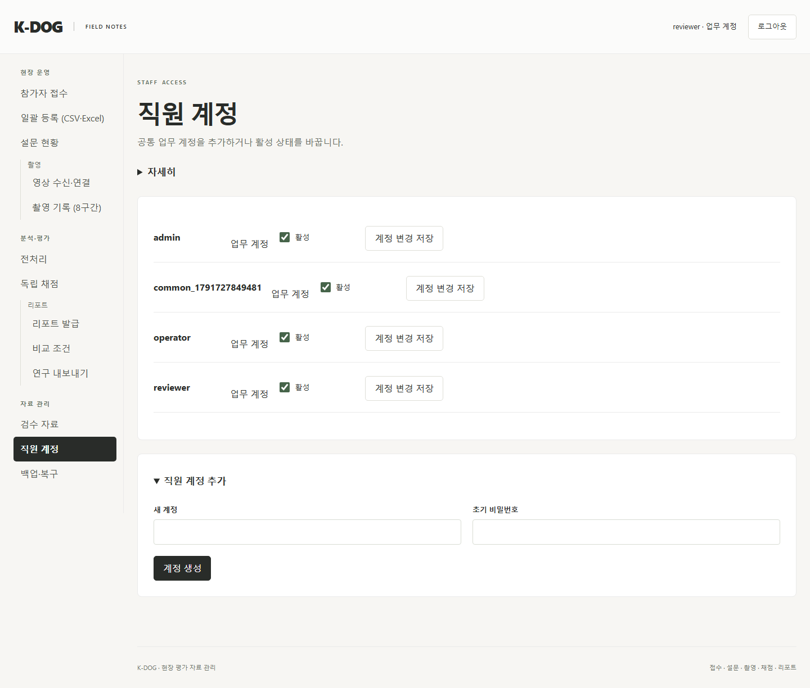
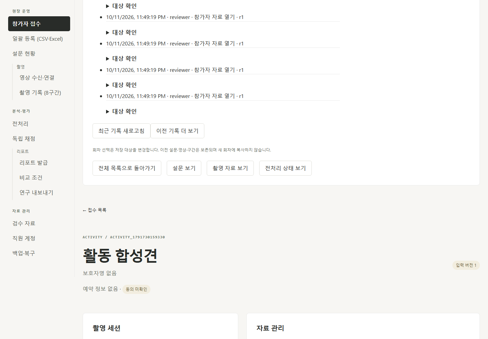
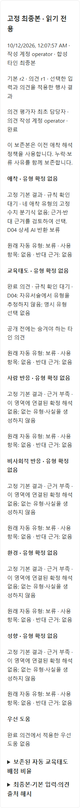
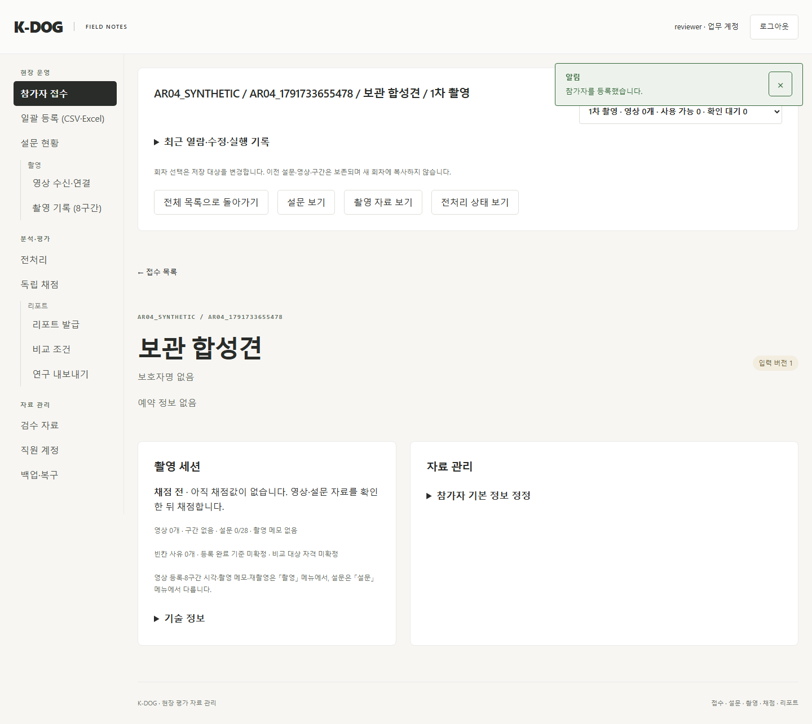

# K-DOG 업무 권한 단순화 구현 실행 기록

버전: v1.0 · 2026-10-11 · 구현 시작 기준: `main / 0dd9ad8`

2026-10-11 `/goal` 지시에 따라 AR01~AR07 구현을 시작했다. PR별 구현 → 검증 → 독립 cold review → 수용 건만 수정 → 문서 갱신 → 병합 순서다. AR01~AR06은 중간 운영 배포하지 않는다. 실제 평가 자료 초기화·삭제나 유료 공급자 호출은 실행하지 않는다.

## 1 단계별 완료 체크

| 단계 | 구현 | 검증 | 독립 cold review | 수용 수정·재검증 | 문서 | 병합 |
| --- | --- | --- | --- | --- | --- | --- |
| AR01 | [x] | [x] | [x] | [x] | [x] | [x] PR #75 |
| AR02 | [x] | [x] | [x] | [x] | [x] | [x] PR #76 |
| AR03 | [x] | [x] | [x] | [x] | [x] | [x] PR #77 |
| AR04 | [x] | [x] | [x] | [x] 발견 없음 | [x] | [ ] |
| AR05 | [ ] | [ ] | [ ] | [ ] | [ ] | [ ] |
| AR06 | [ ] | [ ] | [ ] | [ ] | [ ] | [ ] |
| AR07 | [ ] | [ ] | [ ] | [ ] | [ ] | [ ] |

PR 최종 head·merge SHA는 PR 메타데이터로 확인하고 병합 후 다음 단계에서 표와 개별 계획에 기록한다. 계획 검증 대장의 v1.0/v1.1 기록은 당시 문서 검증 이력으로 유지한다.

## 2 AR01 구현과 검증

브랜치: `veluga/ar01-common-business-access`. [PR #75](https://github.com/syleeVeluga/k-dog-proj/pull/75), 최종 head `087ed8790e5e1fba68b1b61c9089540c6b95333b`, merge `af91032e7352283546f8253706cb2057e2e77381` (2026-10-11 14:22:29 UTC). 요구사항: AR-R01·AR-R02·AR-R08·AR-R12의 계정 공통화 범위.

- API reader/writer/administrator와 영상·업로드·촬영·Forms·전처리·분석·채점·비교 내부의 업무 역할 제한을 제거했다. 요청 actor의 활성 계정·세션·CSRF/host와 hash·판본 검사는 유지한다.
- 웹 신규 일반 계정은 `operator`로 저장한다. 역할 선택 UI를 제거하고 기존 reviewer/admin의 role/password hash는 활성 상태 저장과 앱 재시작 후에도 보존한다. 모든 계정이 일반 업무 계정을 생성·활성 관리하며 개발자 생성/승격/변경과 현재 로그인 계정의 비활성화는 거절한다.
- 개발자도 공통 메뉴를 사용하며 `#/developer/settings`에서 공급자 키·AI 설정을 관리한다. 일반 계정의 설정 API·직접 경로는 보호한다. 기존 bootstrap/발행/provision 형식과 lockfile은 유지한다.
- 기존 계정·채점·실행 change의 실제 actor를 검증했다. 진행 집계·담당·최종/리포트 상태와 단계 필터도 공통화했고 `my_sheet`는 개인 출처로 유지한다.

아래 시험은 임시 폴더의 합성 입력만 사용했다. 명령은 해당 backend/frontend 디렉터리에서 실행했다.

| 명령 | 결과 |
| --- | --- |
| `uv run --locked python -X utf8 -m unittest tests.test_business_access_v4 tests.test_intake_api tests.test_intake_v4 tests.test_settings tests.test_settings_v4 tests.test_issued_release -v` | 55개, 53.550초 통과 |
| `uv run --locked python -X utf8 -m unittest tests.test_business_access_v4 tests.test_progress_v4 -v` | 수용 수정 후 16개, 11.047초 통과 |
| `npm run build` | 통과; 기존 500kB chunk 안내 있음 |
| `npm run test:e2e -- navigation.spec.ts settings.spec.ts business-access-v4.spec.ts` | 최종 10개, 14.8초 통과; 계정 생성/로그인·설정 보호·직접 경로·미저장 입력·360/390/768/1440px 메뉴 검증 |
| 내부 권한 영향 회귀 11개 모듈 | 최초 152개에서 옛 권한 기대 14건 수정, 재실행 151개 통과/후보 수 기대 1건 수정. 수정한 comparisons는 최종 추가 회귀에 포함한다 |
| `uv run --locked python -X utf8 -m unittest tests.test_ai_api_v4 tests.test_recording_api_v4 tests.test_forms_presets_v4 tests.test_forms_template_v4 tests.test_comparisons_v4 tests.test_progress_v4 -v` | 최종 54개, 47.599초 통과. 앞선 후보 수 기대 1건과 교수 영상 등록·preset 이름 충돌 기대도 이 재실행에서 해결 확인 |
| `git diff --check` | 통과 |
| 계획 상대 링크와 Git index 확인 | 89개 링크, 누락 0개 |

AI 회귀는 교수 계정 요청 → 다른 업무 계정 stop/retry → fake provider 42항목군 Worker 완료를 검증한다. 실제 유료 호출은 없다. 요청 ID의 actor 귀속·preset 이름 중복·stale revision의 409는 유지하며 일반 역할에 의한 거절과 구별한다. 실제 운영 DB의 S1 초기화는 하지 않았다.

소유·배정·공개 허가/노출 조건은 AR03, 동의·삭제/clean·restore는 AR04, 리포트 특수 교수 접근과 공유 산출물은 AR05에서 제거한다. AR01만으로 통합 전환·운영 배포 완료를 표시하지 않는다.

## 3 AR01 독립 cold review와 수용 판단

`ar01_cold_review`가 계획과 실제 diff/호출 관계를 읽기 전용 검토했다. 발견 1건(P2)을 수용했고 보류/거절 발견은 없다.

| 발견 | 판단·반영 | 재검토 |
| --- | --- | --- |
| 공통 프런트 진행 표시와 reviewer 서버 null 집계가 불일치하여 잘못된 '미배정'/미완료 안내 | 수용. 서버 진행 요약·화면 단계 필터 공통화, 계정별 동일 요약 회귀 | P2 해결 확인. 독립 `tests.test_progress_v4` 11개·diff check 통과, 새 actionable 0건 |

개발자 승격·기존 계정/hash·만료/비활성 인증·내부 업무 접근·실제 actor에 추가 actionable은 없었다. 후속 PR의 소유·동의·리포트 제한을 AR01 결함으로 혼동하지 않았다.

## 4 의존성 확인 — 2026-10-11

공식 PyPI JSON/npm registry 최신 stable tag와 공식 릴리스/API를 온라인 확인했다. 기존 잠금 환경의 정책 변경이며 새 의존성을 도입하지 않는다. 발행/provision 호환과 AR07 통합 검증을 위해 기존 선택판을 유지하고 무관한 업그레이드를 섞지 않는다. Python 3.14와 프로젝트 Node `>=22.12.0` 조건에서 시험·빌드를 실행했고 React/ReactDOM·types 대응판과 lockfile을 유지했다.

| 라이브러리 | 최신 안정판 | 선택판 |
| --- | --- | --- |
| FastAPI / Pydantic / Uvicorn | 0.143.0 / 2.14.0 / 0.54.0 | 0.141.1 / 2.13.5 / 0.52.4 |
| HTTPX / openpyxl / ReportLab / Pillow / cryptography | 0.28.1 / 3.1.5 / 5.0.1 / 12.3.0 / 50.0.2 | 동일 |
| pypdf | 6.20.0 | 6.19.0 |
| React / ReactDOM | 19.3.0 / 19.3.0 | 19.2.8 / 19.2.8 |
| @types/react / @types/react-dom | 19.3.0 / 19.3.0 | 19.2.18 / 19.2.7 |
| TypeScript / Vite / Playwright | 7.0.2 / 8.3.4 / 1.64.0 | 7.0.2 / 8.2.2 / 1.63.0 |

공식 registry: [FastAPI](https://pypi.org/project/fastapi/)·[Pydantic](https://pypi.org/project/pydantic/)·[Uvicorn](https://pypi.org/project/uvicorn/)·[HTTPX](https://pypi.org/project/httpx/)·[openpyxl](https://pypi.org/project/openpyxl/)·[ReportLab](https://pypi.org/project/reportlab/)·[Pillow](https://pypi.org/project/pillow/)·[cryptography](https://pypi.org/project/cryptography/)·[pypdf](https://pypi.org/project/pypdf/), [React](https://registry.npmjs.org/react/latest)·[ReactDOM](https://registry.npmjs.org/react-dom/latest)·[types/react](https://registry.npmjs.org/@types/react/latest)·[types/react-dom](https://registry.npmjs.org/@types/react-dom/latest)·[TypeScript](https://registry.npmjs.org/typescript/latest)·[Vite](https://registry.npmjs.org/vite/latest)·[Playwright](https://www.npmjs.com/package/@playwright/test?activeTab=versions).

릴리스/API: [FastAPI release](https://fastapi.tiangolo.com/release-notes/)·[Depends](https://fastapi.tiangolo.com/tutorial/dependencies/), [Pydantic changelog](https://docs.pydantic.dev/latest/changelog/)·[models](https://docs.pydantic.dev/latest/concepts/models/), [React versions](https://react.dev/versions)·[useEffect](https://react.dev/reference/react/useEffect), [Playwright release](https://playwright.dev/docs/release-notes)·[assertions](https://playwright.dev/docs/test-assertions).

FastAPI 최신판의 breaking-change 항목은 이번 정책 PR에서 자동 교체하지 않았다. 기존 Starlette TestClient의 HTTPX deprecation 안내는 시험 실패가 아니며 HTTPX2 도입을 범위에 추가하지 않았다.

## 5 AR02 구현·검증 — 수용 수정·독립 재검토 완료

기준 merge `af91032`, 브랜치 `veluga/ar02-minimal-activity-records`, [PR #76](https://github.com/syleeVeluga/k-dog-proj/pull/76), 구현 head `1500a1d`, 최종 head `c1e8688769d4920164346f8ae5479a5d01b2fd2e`, merge `c8fb8918ead69e4cb50fe959f0eb115a5433f45c` (2026-10-11 14:54:54 UTC). 새 DB/의존성 없이 `changes`/`Store.audit`를 재사용한다. 의존성은 §4의 같은 날짜 공식 버전 검증과 잠금 환경을 유지한다.

- 주요 참가자·촬영·시트 현재/보존본·기본 결과·의견·최종·검수 참고·비교집단·외부 비교·export 상세는 명시 `purpose=open`만 기록한다. 목록·자동 상세 갱신·기록 조회는 기록하지 않는다.
- 원본 영상/전처리 클립은 「영상 열기」에서 서버의 파일 연결·해시 검증 후 1건을 남긴다. 재생 preload/seek/Range는 기록하지 않으며 다시 여는 동작은 별도 제공 사실로 남긴다. 원본 파일/export 다운로드는 실제 actor·대상·형식을 기록한다.
- 시트·입력의 revision/purpose/initial_submission·원본 bytes는 열기로 바꾸지 않는다. 저장·실행·중지·재시도·발급은 기존 event를 재사용한다. 기록 실패 시 성공 저장을 채택하지 않는 기존 transaction을 시험했다.
- 참가자와 검수 참고/집단/export 상세에 최근 이력을 접어서 표시한다. 서버 시각·rowid 역순 20건과 더 보기만 제공하며, 이력 응답에는 비밀번호·키·참가자 원문·상세 변경 원문을 반환하지 않는다. 모든 활성 계정이 등록된 대상의 최소 이력을 조회한다.

| 검증 | 결과 |
| --- | --- |
| `tests.test_business_access_v4` | 5개, 8.826초 통과 |
| `tests.test_activity_v4 tests.test_sheets_api_v4 tests.test_exports_v4` | 20개, 28.863초 통과 |
| `tests.test_activity_v4 tests.test_opinions_api_v4 tests.test_report_api_v4 tests.test_research_api_v4 tests.test_comparisons_api_v4 tests.test_external_comparisons_v4 tests.test_preprocess_api_v4 tests.test_recording_api_v4` | 32개, 64.402초 통과 |
| 명시 의견/최종/참고/export와 리포트 추가 회귀 | 31개 중 30통과, AR01 공통 시트 생성의 옛 403 기대 1개 수정. 해당 시험과 명시 열기 관련 9개를 21.951초에 재검증 통과 |
| 실제 합성 FFmpeg 클립 명시 열기·반복 Range·기본 결과 현재/보존 판본 | 1개, 5.941초 통과 |
| 공통 대상 이력·다른 계정의 export 이력·등록 안 된 대상 404 | `tests.test_activity_v4 tests.test_research_api_v4` 6개, 12.791초 통과 |
| cold review 수용 후 페이지 삽입·촬영 판본/회차·영상/기본 결과·공통 이력 | `tests.test_activity_v4 tests.test_recording_api_v4 tests.test_preprocess_api_v4 tests.test_research_api_v4` 17개, 28.810초 통과 |
| `npm run build` | 통과; 기존 chunk 안내 유지 |
| `npm run test:e2e -- activity-v4.spec.ts navigation.spec.ts business-access-v4.spec.ts` | 최종 10개, 16.8초 통과. 초기 로그인 응답 대기 누락을 시험에서 보완 |
| 수용 수정 E2E | 관련 재실행에서 공통 계정/메뉴 9개 통과. 이력 시험의 등록 사건은 첫20개가 아닌 더 보기 이후에 있음으로 기대를 수정, 이력 1개 최종 7.7초 통과. 삽입 중 26행·내부 접기·폴링 무증가 검증 |
| diff check·계획 상대 링크와 Git index | 통과·91개 링크, 누락 0개 |

추가 회귀의 AR01 옛 외부 근거 업로드 역할 기대 2건도 공통 허용으로 갱신했다. 기존 변조·권한 비활성·stale 판본·동의·파일 연결 검사는 유지하며 후속 AR03~AR05 제거 범위와 구분한다.

### AR02 독립 cold review·수용 판단

`ar01_cold_review`가 계획·main 대비 diff·실제 합성 API를 독립 검토했다. P2 3건 모두 수용했으며 보류/거절 건은 없다.

| 발견 | 수용 수정 | 검증 |
| --- | --- | --- |
| 페이지 사이 새 사건 삽입 시 offset 중복 | 최초 max rowid 경계로 이력과 연관 target 집합을 고정하고 더 보기에 같은 경계를 전달 | API 삽입 중 두 페이지 중복 0개 |
| 내부 「대상 확인」 toggle이 바깥 load(0)를 호출 | event.target=currentTarget인 바깥 접기만 조회 | 브라우저 26행 유지 회귀 |
| 촬영 열람 판본 미기록·회차 미표시 | state가 실제 읽은 input_revision을 반환·open에 기록, 대상 확인에 회차/클립 표시 | 촬영 API 실제 revision/session 사건 일치 |

기존 자동 폴링의 최초 열기 표식은 요청 전에 소비하여 최초 응답 유실 후 polling이 재열람 event를 만들지 않게 했다. 새 snapshot 경계는 읽기 페이지 계약이며 DB/사건 스키마/추출·합병을 도입하지 않는다. 독립 재검토에서 P2 3건 모두 해결·새 actionable 0건을 확인했다. 독립 합성 재현도 페이지 간 중복 change_id 0개·실제 촬영 r3 사건을 확인했고 diff check는 통과했다.

## 6 AR03 공유 채점과 해석

기준 `main / c8fb891`, 브랜치 `veluga/ar03-shared-scoring`, [PR #77](https://github.com/syleeVeluga/k-dog-proj/pull/77), 구현 커밋 `4b76a59`, 최종 head `79335c6eac52656dfb0160f92787ebb88d1a412b`, merge `1986e227ec5b4b6d325b39e3ba08c8256669935e` (2026-10-11 15:22:28 UTC). 구현일 2026-10-11~12. 의존성은 §4 공식 검증·잠금판을 유지하고 신규 의존성 없이 정책과 계약을 변경했다.

- 활성 업무 계정은 모든 시트 현재/보존 판본·기본 결과·의견·최종을 조회하고 수정한다. 배정 없이 채점을 시작하며 원평가자 정보는 출처다. 소유 계정 비활성·옛 배정 active false·grant 없음도 업무 접근을 막지 않는다.
- 운영 grant/reveal/배정 취소/시트 재개방 API와 실행 함수/고아 DTO를 제거했다. 제출본 수정 저장은 자동 새 draft revision이며 최초 제출 참조·이전 파일 bytes·original rater_id/rater_kind는 보존하고 실제 저장 actor를 기록한다. 완료/사용 중단 의견도 새 판본으로 다시 작성한다.
- AR02의 명시 open 사건에서 원평가자의 사전 타결과 열람을 읽는다. 제출 사건의 rowid 경계로 최초 제출 의미를 고정하며 제3자 후행 열람이나 후속 편집은 최초 독립본을 바꾸지 않는다. 과거 exposure/grant는 읽기 전용 출처로 보존한다. 열람으로 시트 revision/purpose/initial_submission을 쓰지 않는다.
- AI 관찰/판정의 사람 수정도 새 수동 판본이며 AI 원래 rater·원본 bytes를 보존한다. manual_modified·수동 판정 출처와 실제 actor를 표시하고 후속 계산/최종의 독립 AI 표시는 제외한다. 고정 입력·관찰 범위·필수/결측·변조·409 보호는 유지한다.
- 화면은 모든 시트를 열고 배정/공개 승인 없이 작성·저장·제출본 수정·이전 판본·기록을 사용한다. 타인 해석은 바로 표시하며 명시 열람을 기존 활동 사건에 기록한다.

| 검증 | 결과 |
| --- | --- |
| 핵심 8개 모듈: sheets/sheets_api/judgements/opinions/final_results/disclosures/opinions_api/attachment_ai | 최종 78개, 92.377초 통과. 첫 실행의 옛 권한/잠금 기대를 공통 접근과 원본 보존으로 갱신했으며 변조·범위·충돌 회귀는 유지 |
| 최종 typed 활동 응답·4계정 실제 API·노출·변조 | `tests.test_disclosures_v4 tests.test_sheets_api_v4` 9개, 10.981초 통과 |
| activity/ai_api/preprocess_api/report_api/report_validation/report_acceptance 영향 회귀 | 22개 중 21통과, 전처리의 옛 타평가자403 기대 1건을200으로 갱신; 해당 실제 FFmpeg 클립/결과 회귀 1개, 6.001초 재실행 통과 |
| `npm run build` | 최종 통과, 기존 500kB chunk 안내 유지 |
| `npm run test:e2e -- scoring-v4.spec.ts judgements-v4.spec.ts opinions-v4.spec.ts` | 최종5개, 36.3초 통과. 직접 타의견/최종 열람, 제출본 수정, 409 미저장 입력 유지, 이전판본, 360px 확인 |
| 출처 존재/비활성 원평가자·공통 API | 4개, 6.154초 통과. 존재하지 않는 FK 출처는422이며 계정의 비활성·role은 접근 조건이 아님 |
| 추가 AI 노출 수용 후 backend/build/E2E | 관련40개, 27.681초 통과·build 통과·E2E5개, 37.2초 통과 |
| `git diff --check`·계획 index 링크 | 통과·93개, 누락0 |

A가 배정 없이 생성 → B가 제출/제출본 수정 → C가 본인 시트 없이 현재/보존본 열람 → D가 고정 계산/최종 생성하는 실제 HTTP 회귀를 추가했다. AI 원본 사람 수정→재제출→기본 계산→최종의 manual 출처와 최초 bytes도 검증했다. 공급자는 fake/synthetic이며 운영 자료·실제 유료 호출은 사용하지 않았다.

### 독립 cold review·수용 판단

`ar01_cold_review`의 독립 제품 검토 발견 3건을 수용했고 재검토에서 해결 확인했다. 추가 P2 1건도 수용했다. 최종 독립 재검토에서 4건 모두 해결·신규 actionable0을 확인했다.

| 발견 | 수용 수정·회귀 |
| --- | --- |
| P1 최초 제출판본 계산에 현재 후속 편집 문맥이 섞임 | create/revise의 evaluation_context를 실제 pinned SheetDocument로 계산. 최초 independent 제출→타인 현재 review 편집→최초 판본 재계산의 독립 맥락 유지 회귀 |
| P1 사람이 수정한 AI 관찰의 최종을 최초 독립 AI로 표시 | manual_modified·수동 판정·후속 기본 revision을 제외하고 계약 검증도 일치. AI 사람 수정→계산→최종에서 independent_ai=false·원본 hash 유지 |
| P2 AI 명시 열람이 AI 노출 표시/계산에 누락 | 실제 명시 sheet/basic/의견/final의 pinned AI 원자료 출처로 effective_ai_exposed와 후속 저장/계산 context를 계산. 최초 draft/AI 원본 bytes 보존 회귀 |
| P2 자기 조립 최종의 다른 원평가자 출처를 자기 결과로 오인 | 최종/의견의 실제 고정 기본 원평가자와 해석 작성자를 함께 확인. 다른 평가 기본을 본인이 조립·열람해도 초안은 노출 기록으로 분류 |

AR04 동의/삭제/보관 및 AR05 리포트/내보내기 소유 조건은 해당 계획으로 인계한다. 이 PR만으로 통합 운영 전환 완료를 표시하지 않는다.

최종 독립 재검토는 추가 AI 노출 재현에서 읽기 표시 True·원본 상태/bytes 보존·제출/계산 ai_exposed=True·최초 AI bytes 보존을 확인했다. 독립 회귀40개(23.883초) 통과, 신규 actionable0. 앞선 재검토의 52개 통과와 원평가 출처/FK 검토도 기록하며 중복 시험 수를 총합 성공 수로 과장하지 않는다.

## 7 AR04 구현·검증·독립 cold review

2026-10-12, 브랜치 `veluga/ar04-consent-retention`, 기준 `1986e22` (AR03 merge), [PR #78](https://github.com/syleeVeluga/k-dog-proj/pull/78), 구현 head `3f88726`. 요구사항 AR-R06·AR-R07·AR-R10·AR-R11. 의존성은 §4 공식 확인과 같은 잠금판이며 추가/업그레이드 없음. 최종 head·merge는 병합 후 기록한다.

- 목록/영상/업로드/촬영/전처리/AI/채점/리포트/비교/검수/export/Worker/benchmark의 live·frozen 동의·삭제 차단을 제거했다. product 삭제 API·버튼·상태와 identity/Forms/검수 source tombstone을 제거했다. 역사 Manifest·DB·대장 metadata는 보존하며 새 정상 DTO/화면의 조건에서 제외한다. 생략한 사례 수정은 옛 동의값을 유지한다.
- clean은 참조 hash 전체 검증 후 현재 참조하지 않는 관리 경로의 고아파일만 제거한다. 연쇄 DB 삭제·purge·VACUUM은 없다. restore는 백업 시점 DB/자료/changes만 복원하며 현재 삭제대장·백업 이후 event를 추출·병합하거나 lease를 다시 쓰지 않는다. 세션 초기화·S1 초기화 경계·hash/FK/offline/목적지 검사는 유지한다.
- 연결된 receipt 취소는 원자료를 연쇄 제거하지 않는다. 실제 활성 계정·세션·대상·입력 판본·hash·중지·lease/token 검사는 유지하며 원격 임시 파일/만료한 미연결 수신 정리는 유지한다. 옛 CLI `--purge-deleted`는 code 2 사용 오류이고 자료는 그대로다.
- export의 시트 읽기에 남은 AR03 공개 허가 조건은 영향 회귀에서 발견해 공통 자료 접근으로 맞췄다. 최초 제출 후 다른 사람이 읽은 원평가본의 독립성은 유지하며 후속 편집판은 review로 구분한다. export 생성자·U08 리포트 조건·외부 기준 결재는 AR05, 일괄 입력의 동의 열은 AR06에서 제거한다.

| 검증 | 결과 |
| --- | --- |
| settings/deletion_restore/uploads/preprocess/run/forms/exports/validation 핵심 | 최종 152개 중 151통과(153.800초), 남은 옛 후행 열람 독립성 기대를 최초 제출/후속 편집 분리로 수정 후 아래 최종 8개에서 통과 확인 |
| 영향 회귀 intake/recording/upload/forms/comparison/report/research/benchmark/history | 172개 중 168통과(227.975초), 옛 차단 기대·중복 영상·로그인 세션 fixture·후행 편집 fixture 4건을 수정 후 아래 최종 8개에서 재검증. 앞선 222개 실행의 구 기대 실패도 갱신 |
| `tests.test_retention_v4` 초기 종단 4개 | 114.680초 통과. 12개 상태 조합 목록·영상·채점·최종·리포트·집단·export·clean·반복 restore, flag 변경 Worker, 옛 CLI 오류 |
| 누락 참조/고아파일 보존 추가 1개 | 1.381초 통과. 유실을 성공 복구로 표시하지 않고 참조 검사 실패 시 고아파일도 보존 |
| 최종 exports/intake/benchmark/history/preserved_media 회귀 8개 | 9.488초 통과. 위 두 실행의 남은 기대 수정, 원본/부모 hash·세션 폐기·신규 후속 편집 분류 확인 |
| 실제 AI handler 상태 행렬 + 전처리 flag/판본 채택 2개 | 242.520초 통과. 12조합×42항목군 fake provider, 각 86개 관찰/기본 결과 실제 채택; 옛 flag 비차단·실제 revision 충돌 차단 |
| `npm run build` | 통과, 기존 500kB chunk 안내 유지 |
| `npm run test:e2e -- business-access-v4.spec.ts retention-v4.spec.ts` | 2개, 8.0초 통과. 동의 입력/삭제 버튼 없는 접수·상세/공통 계정 |
| 최종 화면 캡처 E2E | retention 1개, 5.8초 통과. 유한 CSS 애니메이션 종료 상태 캡처·육안 확인 |
| diff check·Graft build·계획 Git index 링크 | 통과·그래프 최신·95개 링크 누락0 |

초기 실패는 합성 fixture와 종전 정책 기대를 바꾸는 과정으로 기록한다. 최종 집중 재검증과 초기 묶음 실행을 단일 전부 통과 실행으로 합산하지 않는다. 유료 공급자 호출·실제 운영 DB/자료 초기화·삭제·중간 배포는 하지 않았다.

`ar01_cold_review`가 Graft 호출 관계와 diff를 읽기 전용으로 독립 검토했다. actionable 0건으로 수용 수정이 필요한 발견은 없었다. 동의/삭제 차단 제거·고정 판본·Worker lease/token·참조 보존 후 고아 정리·snapshot 복원·시험 무결성을 확인하고 독립 합성 회귀 13개(19.584초)를 통과했다. AR05/AR06 후속 범위와 구분했다.

