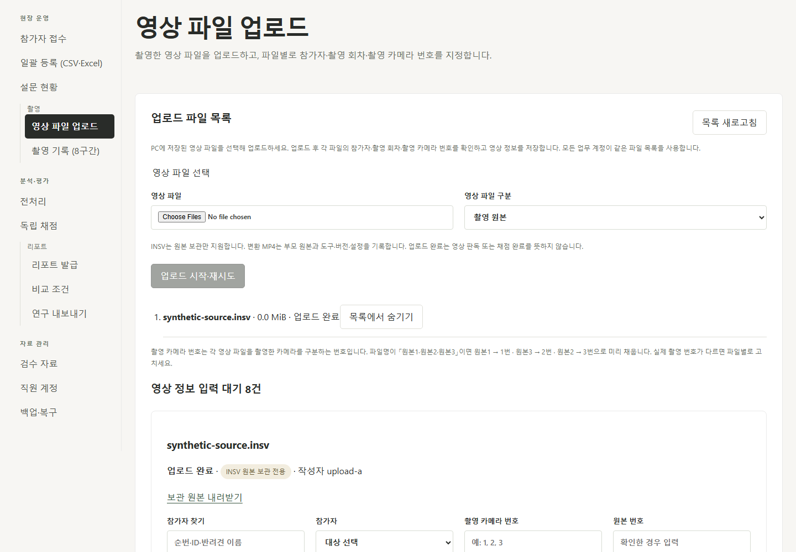

# K-DOG 영상 파일 업로드 표현 정리

버전: v1.0 · 2026-10-12 · 기준 commit: `c5effb8` · 브랜치: `veluga/video-upload-wording`

## 사용자 결정과 반영 범위

2026-10-12 로컬 테스트에서 사용자는 파일을 선택해 올리는 화면의 ‘수신’ 표현과 실제 카메라 기기 연결로 읽히는 ‘카메라 연결’ 표현을 수정하도록 요청했다. 영상 파일별 촬영 카메라 번호를 지정하는 작업으로 표시한다.

- 메뉴·제목은 「영상 파일 업로드」, 목록은 「업로드 파일 목록」, 처리 버튼은 「업로드 시작·재시도」로 표시한다. 안내·상태·취소·업무 기록의 표시명도 업로드 표현을 사용한다.
- 파일별로 참가자·촬영 회차·「촬영 카메라 번호」를 확인하고 「영상 정보 저장」을 누른다. 번호 1·2·3을 입력하면 기존 CAM1·CAM2·CAM3 식별자를 API에 전달한다. 기존 영문 식별자 입력도 보존한다.
- 파일명 원본1·원본3·원본2의 촬영 카메라 번호 제안은 1·2·3이며 기존 원본 번호 대응을 유지한다. 제안 번호를 고치면 기존 원본 번호 자동 판단과 같은 기준으로 처리한다.
- 업로드 완료와 영상 판독/채점 완료의 구분, 참가자·회차 고정, 중복 번호 경고, 판본 충돌, 실패 재시도·완료 파일 재전송 방지, INSV 보관 전용 계약을 유지한다. API·DB 식별자·평가 규칙은 변경하지 않았다.
- [운영 안내](../docs/PILOT_OPERATIONS.md)의 현재 업로드 절차를 같은 표현으로 갱신했다. 이전 단계의 수신/연결 구현·검증 기록은 당시 이력으로 유지한다.

## 버전 확인

2026-10-12 공식 문서와 npm registry의 최신 안정판·선택판 engine/peer 조건을 확인했다. Node.js 24.18.1에서 아래 잠금판을 사용한다. 현재 검증된 프로젝트를 로컬에 반영하는 수정이므로 관련 없는 의존성 업그레이드는 하지 않았다. manifest/lockfile 변경과 새 의존성은 없다.

| 패키지 | 최신 / 선택 | 공식 근거 |
| --- | --- | --- |
| React / React DOM | 19.3.0 / 19.2.8 | [React 판본](https://react.dev/versions), [React npm](https://www.npmjs.com/package/react), [React DOM npm](https://www.npmjs.com/package/react-dom) |
| Vite | 8.3.4 / 8.2.2 | [설치·Node 호환](https://vite.dev/guide/), [Vite 8](https://vite.dev/blog/announcing-vite8), [npm](https://www.npmjs.com/package/vite) |
| TypeScript | 7.0.2 / 7.0.2 | [npm](https://www.npmjs.com/package/typescript) |
| Playwright test | 1.64.0 / 1.63.0 | [npm](https://www.npmjs.com/package/@playwright/test) |

React DOM 선택판의 React peer는 `^19.2.8`, Vite 선택판의 Node 조건은 `^20.19.0 || >=22.12.0`, TypeScript는 `>=16.20.0`, Playwright는 `>=20`으로 확인했다.

## 실제 검증

`frontend/`에서 실행했다. 시험은 8765 포트의 임시 합성 자료를 사용하고 로컬 사용자는 8000 포트의 별도 테스트 자료를 계속 사용한다.

```powershell
npm run build
npm run test:e2e -- tests/recording-split-v4.spec.ts tests/uploads-v4.spec.ts tests/navigation.spec.ts tests/intake.spec.ts tests/context.spec.ts tests/copy-guard.spec.ts tests/scenario-staff.spec.ts
```

- build 통과, 관련 E2E 28개 전부 통과(56.9초). 파일별 숫자 입력 → CAM 식별자·원본 번호 저장, 번호 정정, 중복 경고, 세 브라우저의 동시 저장 충돌·재접속, 완료 파일 재전송 없음, 취소, 메뉴·모바일·설정 권한을 검증했다.
- 화면 PNG를 직접 확인했다. 자체 차이 검토에서 숫자 표시/저장 대응과 기존 API·입력 판본·원본 hash 처리 유지, 관련 선택자 누락 없음을 확인했다. 독립 cold review 또는 전체 제품 인수를 새로 수행한 것으로 기록하지 않는다.
- 로컬 8000 포트의 S1 health와 새 JS 자산 제공을 확인했다. 외부 AI 호출 0건. 실자료·공급자 품질·현장 3PC 검수와 구분한다.


